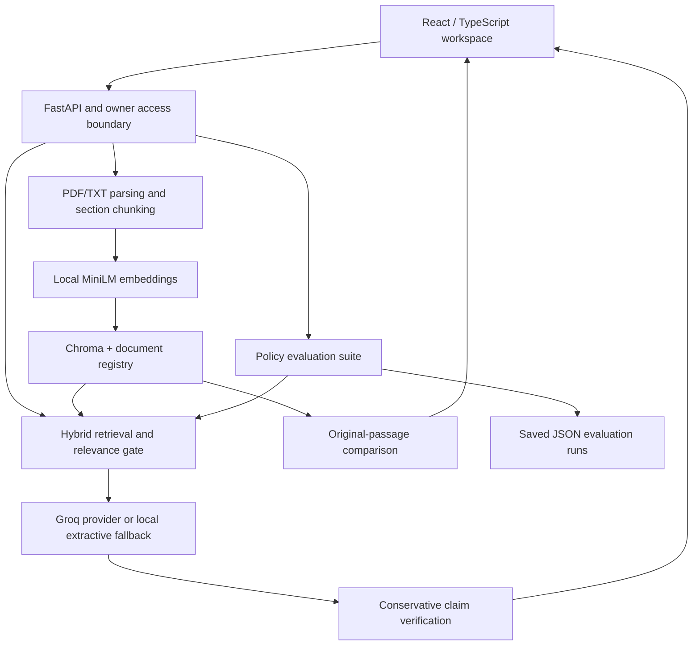

# Vericore — Evidence-First Document Intelligence

Ask questions across documents, inspect the original passages behind each claim, compare policy versions, and measure when the system should refuse an answer.

**[Live application](https://vericore-evidence.onrender.com) · [Workspace](https://vericore-evidence.onrender.com/app) · [Upgrade source](https://github.com/Lingu17/Vericore---Evidence-First-Document-Intelligence/tree/codex/evidence-policy-demo) · [Implementation notes](https://github.com/Lingu17/Vericore---Evidence-First-Document-Intelligence/blob/codex/evidence-policy-demo/docs/IMPLEMENTATION.md)**

> The live application runs the `codex/evidence-policy-demo` branch. The application upgrade is tracked in [PR #1](https://github.com/Lingu17/Vericore---Evidence-First-Document-Intelligence/pull/1). This README describes that version; use the branch shown in the setup instructions to run it locally.


## Contents

- [End-to-end demonstration](#end-to-end-demonstration)
- [Features](#features)
- [Architecture](#architecture)
- [Local setup](#local-setup)
- [Configuration](#configuration)
- [Evaluation and verification](#evaluation-and-verification)
- [Deployment](#deployment)
- [API](#api)
- [Security and limitations](#security-and-limitations)
- [Troubleshooting](#troubleshooting)
- [Contributing](#contributing)

## End-to-end demonstration

1. Open the workspace and sign in with the deployment owner's credentials. Local development can run without a password.
2. Use the demo action to upload **Employee Policy 2025** and **Employee Policy 2026** through the normal ingestion pipeline. You can also upload the bundled TXT files manually.
3. Ask **“How many annual leave days do employees receive in each policy version?”** The documents contain **20 days in 2025** and **25 days in 2026**. Inspect the original passage attached to each displayed claim.
4. Ask **“How many remote work days per week are allowed in each policy version?”** Inspect the **2-day** and **3-day** clauses. Open Compare to see both sources and the changed values. Differences are reported as potential conflicts.
5. Ask **“What is the employee stock option vesting schedule?”** Neither policy answers this. The expected response is **“Information not available in the uploaded documents.”**
6. Open Evaluations and run these same three questions against the two policies. Inspect actual responses, expected criteria, sources, metrics, and the saved run.

The fixtures are in [`backend/sample_documents`](https://github.com/Lingu17/Vericore---Evidence-First-Document-Intelligence/tree/codex/evidence-policy-demo/backend/sample_documents). The demo does not inject prewritten answers or synthetic search results.

## Features

| Area | Implemented behavior |
| --- | --- |
| Document ingestion | PDF/TXT uploads, bounded 10 MB reads, parsing, section-aware chunks, local embeddings, document registry, and document deletion |
| Cross-document questions | Hybrid semantic/lexical retrieval, relevance gating, scoped questions, and retention of relevant policy versions |
| Evidence trail | Claim-linked original passages with document, page, section, and chunk references |
| Answer verification | Conservative passage matching; unsupported or partially supported statements are withheld |
| Version comparison | Added, removed, and modified passages, changed words and values, and side-by-side evidence |
| Conflict inspection | Potential numeric conflicts link to both original clauses |
| Refusal | Explicit refusal when retrieved evidence cannot support an answer |
| Evaluation Lab | Fixed three-question policy suite, actual responses, expected criteria, retrieval metrics, citation coverage, unsupported rate, refusal correctness, latency, and saved JSON runs |
| Provider settings | Authenticated owner can test and temporarily activate a Groq key/model, then restore environment settings |
| Workspace access | Owner login, short-lived HttpOnly sessions, logout, and private API protection |
| Interface | Landing page, responsive workspace, source inspection, comparison, evaluation history, provider settings, keyboard controls, and reduced-motion support |
| Deployment | Multi-stage Docker build serving React and FastAPI together; Render Free blueprint; optional ONNX embeddings |

## Architecture



The existing RAG pipeline remains the foundation. Chroma stores the document chunks and embeddings; a JSON registry records documents. Evaluation records live beside the configured Chroma data. Groq remains behind the provider service, with timeouts, validated responses, and sanitized failures. When no usable provider is configured, the application can return locally extracted passages.

| Layer | Technology |
| --- | --- |
| Frontend | React 18, TypeScript, Vite 7, React Router 7, Tailwind CSS 4 |
| API | Python 3.11, FastAPI, Uvicorn |
| PDF extraction | PyMuPDF |
| Embeddings | `all-MiniLM-L6-v2`, SentenceTransformers or ONNX Runtime |
| Storage | Chroma, JSON document registry and evaluation records |
| Generation | Groq; local extractive fallback |
| Hosting | Docker on Render Free |

```text
backend/
  app/api/             # Auth, documents, chat, health, comparison, evaluation, provider
  app/core/            # Configuration and access controls
  app/services/        # Ingestion, embeddings, retrieval, generation, verification
  sample_documents/    # Employee policy fixtures and sample documents
  tests/               # Backend regression and feature checks
  evaluate.py          # Local evaluation client
frontend/
  src/                 # Landing, login, workspace, evidence and lab interfaces
  public/              # Static assets and workspace preview
docs/IMPLEMENTATION.md # Detailed implementation and setup notes
Dockerfile             # Combined frontend/backend image
render.yaml            # Free Render deployment blueprint
```

## Local setup

Prerequisites: **Python 3.11**, **Node.js 22.12 or newer**, Git, and network access for the initial embedding-model download.

### 1. Get the upgraded source

```bash
git clone --branch codex/evidence-policy-demo https://github.com/Lingu17/Vericore---Evidence-First-Document-Intelligence.git
cd Vericore---Evidence-First-Document-Intelligence
```

### 2. Start the backend

Windows PowerShell:

```powershell
cd backend
python -m venv .venv
.\.venv\Scripts\Activate.ps1
python -m pip install -r requirements.txt
Copy-Item .env.example .env
python -m uvicorn app.main:app --host 127.0.0.1 --port 8000
```

macOS/Linux:

```bash
cd backend
python3 -m venv .venv
source .venv/bin/activate
python -m pip install -r requirements.txt
cp .env.example .env
python -m uvicorn app.main:app --host 127.0.0.1 --port 8000
```

Edit `backend/.env`: leave `GROQ_API_KEY` empty to use local extractive answers, or supply your own valid key. The example placeholder is not a credential. Set `WORKSPACE_PASSWORD` to enable owner login locally. Keep secrets out of Git.

### 3. Start the frontend

In a second terminal, from the repository root:

```bash
cd frontend
npm ci
npm run dev -- --host 127.0.0.1
```

Open [http://127.0.0.1:5173](http://127.0.0.1:5173). Backend health is at [http://127.0.0.1:8000/health](http://127.0.0.1:8000/health); local API documentation is at `/docs`.

### Optional ONNX embeddings

Install `backend/requirements-onnx.txt` and set `EMBEDDING_BACKEND=onnx`. This uses the same MiniLM model and tokenizer with mean pooling and normalization. The Docker image selects ONNX and downloads its model during the build.

## Configuration

Use `backend/.env.example` as a starting point. The full settings are in [`backend/app/core/config.py`](https://github.com/Lingu17/Vericore---Evidence-First-Document-Intelligence/blob/codex/evidence-policy-demo/backend/app/core/config.py).

| Variable | Purpose |
| --- | --- |
| `GROQ_API_KEY` | Optional server-side Groq credential |
| `GROQ_MODEL` | Provider model; default `openai/gpt-oss-20b` |
| `PROVIDER_TIMEOUT_SECONDS` | Provider timeout; default 30 seconds |
| `WORKSPACE_USERNAME` | Owner username; default `owner` |
| `WORKSPACE_PASSWORD` | Owner password; required in production |
| `ENV` | `development` or `production`; production cookies require HTTPS |
| `CHROMA_PATH` | Chroma, registry, and evaluation storage location |
| `EMBEDDING_BACKEND` | `sentence_transformers` or `onnx` |
| `EMBEDDING_MODEL` | Local embedding model; default `all-MiniLM-L6-v2` |
| `MAX_FILE_SIZE_MB` | Upload limit; default 10 MB |
| `REQUESTS_PER_MINUTE` | Per-process mutation rate limit; default 60 |
| `MAX_OUTPUT_TOKENS` | Generation output budget; default 128 |
| `MAX_HISTORY_MESSAGES` | Retained conversation history; default 2 |
| `USE_MOCK_LLM` | Test setting; keep `false` for normal operation |

Retrieval thresholds, candidate counts, chunk size, overlap, and CORS settings can also be configured. Changing embedding models for an existing collection requires compatible embeddings or reindexing.

## Evaluation and verification

The Evaluation Lab runs actual retrieval, answer generation, and verification for the fixed policy scenario. A result is evaluated against literal expected values, required document sources, and conflict/refusal criteria. Retrieval metrics use expected chunk IDs; citation coverage measures evidence links. Token usage and cost remain unavailable/null when they are not reported.

### Recorded hosted demonstration

The following is a historical run on **12 October 2026**, using the two bundled policies and the local extractive fallback. It is a small regression scenario, not a general accuracy benchmark.

| Question | Result | Latency | Retrieval precision/recall | Citation coverage | Unsupported rate |
| --- | --- | --- | --- | --- | --- |
| Annual leave across both versions | Passed: 20 / 25 days, both sources | 287.67 ms | 100% / 100% | 100% | 0% |
| Remote work across both versions | Passed: 2 / 3 days, both sources | 293.18 ms | 100% / 100% | 100% | 0% |
| Stock-option vesting | Passed: exact refusal | 205.41 ms | N/A | N/A | N/A |

**Recorded outcome: 3/3 passed.** Run the suite yourself to inspect current results. Uploaded files and saved runs on the free hosted deployment can disappear after a restart.

### Run the local evaluation client

With the development backend running and `WORKSPACE_PASSWORD` empty:

```bash
cd backend
python evaluate.py --url http://127.0.0.1:8000 --output evaluation-result.json
```

The client uploads/deduplicates the fixtures, runs the suite, writes the response to JSON, and exits unsuccessfully if a case fails. This client does not supply authentication; use the authenticated Evaluation Lab for the protected deployment.

### Run checks

From `backend`, PowerShell:

```powershell
$env:CHROMA_PATH = './test_chroma'
$env:USE_MOCK_LLM = 'true'
python -m pytest -q
```

Use a disposable test data directory, then unset these test environment variables before starting the normal application. To check the deployment embedding engine, install the ONNX requirements and repeat with `EMBEDDING_BACKEND=onnx` and a separate test directory.

From `frontend`:

```bash
npm run build
npm audit
```

Recorded verification for the upgrade: **49 backend tests passed on each embedding engine**, frontend TypeScript/production build passed, and npm audit reported zero vulnerabilities at the time of testing. MiniLM parity on three scenario texts was within `1e-5`. Local desktop/mobile browser checks and hosted Docker startup were also verified. There is currently no configured frontend unit-test or lint suite. These results do not replace checks after future dependency changes.

## Deployment

### Docker

From the repository root on the upgrade branch:

```bash
docker build -t vericore .
docker run --rm -p 8000:8000 -v vericore-data:/data vericore
```

Open [http://localhost:8000](http://localhost:8000). The image builds the frontend, installs the backend and ONNX model, and runs as a non-root user. The volume preserves local document/evaluation data. For an internet-facing deployment, set `ENV=production`, configure a strong owner password privately, and terminate HTTPS in front of the service.

### Render Free

The repository includes `render.yaml` for a Docker web service with `/health`, production mode, a generated owner password, and an optional Groq secret. Connect the repository, select `codex/evidence-policy-demo`, and create the Blueprint service. Retrieve the generated password from your own Render environment settings; it is never published in this repository.

The current public deployment uses **Render Free**. It may sleep while inactive and take time to start. Its filesystem is ephemeral: uploads, document registry, and evaluation records can reset on restart or redeployment. A durable service needs persistent storage and an appropriate hosting plan. See [Render's free-service documentation](https://render.com/docs/free).

## API

The React client uses the following endpoints. Inspect `/docs` on a running development instance for request/response schemas; production documentation is protected.

| Area | Routes |
| --- | --- |
| Health | `GET /health` |
| Authentication | `GET /api/auth/status`, `POST /api/auth/login`, `POST /api/auth/logout` |
| Documents | `GET /api/documents`, `POST /api/documents/upload`, `DELETE /api/documents` |
| Document detail | `GET` / `DELETE /api/documents/{document_id}` |
| Source exploration | `GET /api/documents/{document_id}/passages`, `GET /api/documents/{document_id}/suggestions` |
| Questions | `POST /api/chat` |
| Demo ingestion | `POST /api/demo` |
| Comparison | `POST /api/compare` |
| Evaluation history/run | `GET` / `POST /api/evaluations` |
| Provider settings | `GET` / `POST` / `DELETE /api/provider`, `POST /api/provider/test` |

Private APIs require owner authentication when workspace access is enabled. Browser clients use the session cookie; Basic authentication is supported for direct API clients. Chat can scope retrieval using document IDs. Comparison accepts the two document IDs. Provider mutations require an authenticated owner even when local workspace login is otherwise disabled.

## Security and limitations

- **Single-owner workspace:** this is not a multi-tenant application. Separate users do not receive isolated document stores.
- **Session protection:** eight-hour sessions use HttpOnly, SameSite=Strict cookies and Secure cookies in production. Logout revokes a session; process restarts clear sessions. Authenticated cross-origin mutations are checked.
- **Credential handling:** provider keys are never returned by the API or stored in browser storage. Keys activated through the UI stay in server memory and disappear on restart. There is no persistent encrypted per-user key vault.
- **Document handling:** uploads have bounded reads and sanitized filenames. Uploaded content is treated as untrusted prompt material; document code is not executed.
- **Evidence limits:** exact passage matching is conservative and can withhold valid paraphrases. An evidence link shows where a statement came from; it does not prove the document itself is true.
- **Conflict limits:** differing numeric clauses are potential conflicts. The system does not determine policy precedence, effective-date applicability, scope, or legal interpretation.
- **Evaluation limits:** the bundled suite contains three fixed policy questions and literal criteria. It does not establish performance for arbitrary corpora or provide a general semantic grader.
- **Provider validation:** a successful live Groq-generated answer was not verified for the recorded hosted run. That run used actual local embeddings, retrieval, and extractive answers.
- **Operational limits:** rate limits and sessions are held per process. The current deployment uses one worker and free ephemeral hosting.

Potential follow-up work includes broader evaluation datasets, frontend automated tests, durable storage, tenant isolation, and stronger semantic verification. These are future work, not current features.

## Troubleshooting

| Symptom | Check |
| --- | --- |
| Hosted page takes time to load | Allow the free Render service to wake up; check `/health` |
| Documents or evaluation history disappeared | Free hosting may have restarted; re-upload or run the demo again |
| First local startup is slow | MiniLM model files must download on the first run |
| Provider rejects a key | Replace the `.env` placeholder with a valid credential or leave it empty; use the owner provider test |
| Answer is refused | Inspect uploaded documents and relevant passages; the conservative verifier requires passage support |
| Frontend cannot reach the backend | Confirm port 8000 is running and use an allowed local origin |
| Cookie login fails in local Docker | Production Secure cookies require HTTPS; use development mode for local HTTP |
| Model dependencies are too heavy | Use the optional ONNX requirements and backend |

## Contributing

Start from the upgrade branch when working on the current deployed functionality. Keep generated `node_modules`, virtual environments, credentials, model caches, and runtime Chroma/evaluation files out of Git. Include the relevant backend checks and production frontend build with application changes. Describe changes to evidence behavior and disclose evaluation limitations.

No `LICENSE` file is currently included in the repository. A license must be added before a specific open-source license can be claimed.
