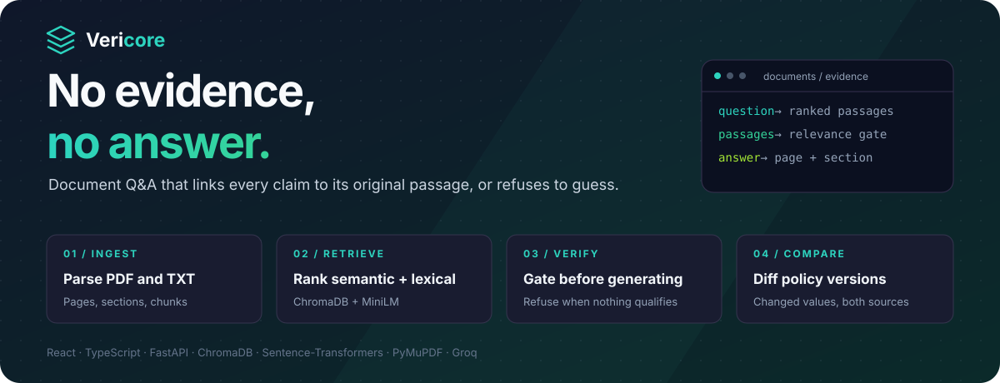
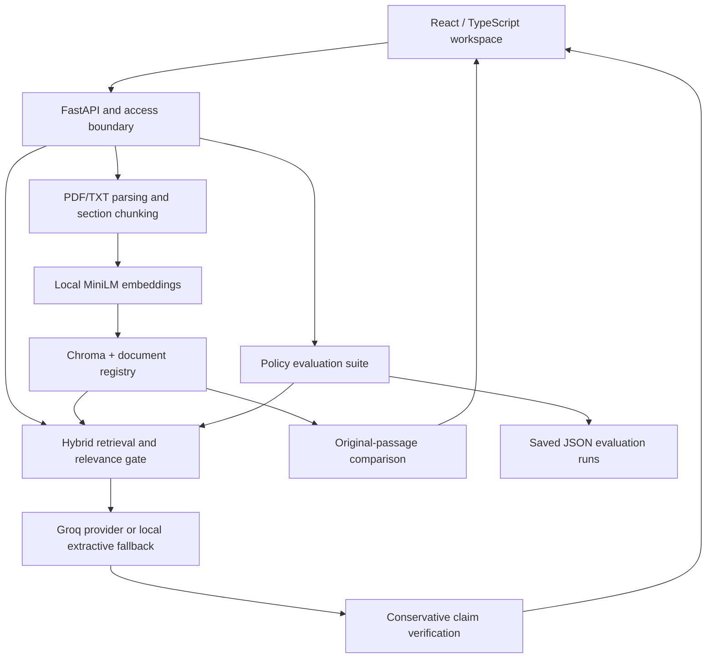

<p align="center">
  
</p>

<p align="center">
  <strong>Evidence-first document intelligence.</strong><br />
  Ask questions across documents, inspect the original passage behind every claim, compare policy versions, and measure when the system should refuse.
</p>

<p align="center">
  <a href="https://vericore-evidence.onrender.com"></a>
  <a href="https://vericore-evidence.onrender.com/app"></a>
</p>

<p align="center">
  
  
  
  
  
</p>

<p align="center">
  <a href="#the-product">Product</a> ·
  <a href="#engineering-decisions">Engineering</a> ·
  <a href="#architecture">Architecture</a> ·
  <a href="#verification">Verification</a> ·
  <a href="#run-locally">Run locally</a> ·
  <a href="#creator">Creator</a>
</p>

> **Which branch is live?** The public deployment runs the [`codex/evidence-policy-demo`](https://github.com/Lingu17/Vericore---Evidence-First-Document-Intelligence/tree/codex/evidence-policy-demo) branch, tracked in [PR #1](https://github.com/Lingu17/Vericore---Evidence-First-Document-Intelligence/pull/1). This README describes that version, and the code links below point to it. The free Render service sleeps when idle, so the first load can take up to a minute.


---

## The product

Ask a chatbot about your HR policy and it will answer confidently, even when the document says nothing on the subject, or when two versions of the policy disagree.

**Vericore answers only from passages it can show you.** Every displayed claim links to the original document, page and section. When retrieval finds nothing that qualifies, it says *"Information not available in the uploaded documents."* without calling the model at all.

| Capability | What you can do |
| :--- | :--- |
| **Document ingestion** | Upload PDF or TXT files (bounded 10 MB reads); they are parsed, split into section-aware chunks, embedded locally and registered. |
| **Cross-document questions** | Hybrid semantic + lexical retrieval with a relevance gate, scoped to selected documents, keeping relevant policy versions side by side. |
| **Evidence trail** | Each claim links to its original passage with document, page, section and chunk references. |
| **Answer verification** | Conservative passage matching; unsupported or partially supported statements are withheld. |
| **Version comparison** | Added, removed and modified passages, changed words and values, and side-by-side evidence. |
| **Conflict inspection** | Differing numeric clauses are flagged as potential conflicts, linked to both original clauses. |
| **Evaluation Lab** | A fixed three-question policy suite with retrieval metrics, citation coverage, unsupported rate, refusal correctness, latency and saved JSON runs. |
| **Public accounts** | Email/password registration, personal Groq key setup and an isolated workspace per account. Google sign-in is implemented and activates once OAuth credentials are configured. |

### A workflow you can follow

**Upload → ask → inspect the passage → compare versions → run the evaluation**

1. Load **Employee Policy 2025** and **Employee Policy 2026** with the demo action (or upload the bundled TXT files).
2. Ask *"How many annual leave days do employees receive in each policy version?"* The documents say **20 days in 2025** and **25 days in 2026**; open the passage behind each claim.
3. Ask *"How many remote work days per week are allowed in each policy version?"* and open **Compare** to see the **2-day** and **3-day** clauses flagged as a potential conflict.
4. Ask *"What is the employee stock option vesting schedule?"* Neither policy covers it, so the answer is an explicit refusal.
5. Open **Evaluations** and run the same three questions; inspect responses, expected criteria, sources and metrics.

The fixtures live in [`backend/sample_documents`](https://github.com/Lingu17/Vericore---Evidence-First-Document-Intelligence/tree/codex/evidence-policy-demo/backend/sample_documents). The demo does not inject prewritten answers or synthetic search results.

## Engineering decisions

| Engineering problem | Implementation | Inspect the code |
| :--- | :--- | :--- |
| Dense retrieval alone matches topics, not answers | Candidates are scored on cosine similarity plus lexical coverage of the question's content terms, then ranked by a hybrid score. | [Hybrid retrieval](https://github.com/Lingu17/Vericore---Evidence-First-Document-Intelligence/blob/codex/evidence-policy-demo/backend/app/services/retriever.py) |
| A question the documents can't support should never reach the model | A relevance gate passes only when the top match clears the semantic threshold or a grounded candidate clears the lexical override; otherwise the API refuses. | [Gate and confidence](https://github.com/Lingu17/Vericore---Evidence-First-Document-Intelligence/blob/codex/evidence-policy-demo/backend/app/services/confidence.py), [chat API](https://github.com/Lingu17/Vericore---Evidence-First-Document-Intelligence/blob/codex/evidence-policy-demo/backend/app/api/chat.py) |
| Generated text can drift from its sources | Claims are matched back to passages conservatively; statements without support are withheld rather than shown. | [Verification](https://github.com/Lingu17/Vericore---Evidence-First-Document-Intelligence/blob/codex/evidence-policy-demo/backend/app/services/verification.py) |
| Two policy versions can silently disagree | Passages are aligned across documents; added, removed and modified text and changed numeric values are reported with both sources. | [Comparison](https://github.com/Lingu17/Vericore---Evidence-First-Document-Intelligence/blob/codex/evidence-policy-demo/backend/app/services/comparison.py) |
| Public users must never see each other's data | Each account gets its own Chroma collection, document registry, evaluation directory, Groq client and answer cache. | [Tenant isolation](https://github.com/Lingu17/Vericore---Evidence-First-Document-Intelligence/blob/codex/evidence-policy-demo/backend/app/core/tenant.py), [accounts](https://github.com/Lingu17/Vericore---Evidence-First-Document-Intelligence/blob/codex/evidence-policy-demo/backend/app/core/accounts.py) |
| "It works on my questions" is not evidence | The Evaluation Lab runs real retrieval, generation and verification against literal expected values and saves each run. | [Evaluation API](https://github.com/Lingu17/Vericore---Evidence-First-Document-Intelligence/blob/codex/evidence-policy-demo/backend/app/api/lab.py), [CLI client](https://github.com/Lingu17/Vericore---Evidence-First-Document-Intelligence/blob/codex/evidence-policy-demo/backend/evaluate.py) |

Passwords use salted scrypt hashes; SQLite stores hashed eight-hour session tokens; public-session cookies are HttpOnly, SameSite=Lax and Secure in production. Google sign-in uses one-use cookie-bound state and PKCE. Groq keys stay in account-specific server memory, are never returned by the API, and must be reconnected after a restart.

## Architecture



| Layer | Technology |
| :--- | :--- |
| Frontend | React 18, TypeScript, Vite 7, React Router 7, Tailwind CSS 4 |
| API | Python 3.11, FastAPI, Uvicorn |
| PDF extraction | PyMuPDF |
| Embeddings | `all-MiniLM-L6-v2` via Sentence-Transformers or ONNX Runtime |
| Storage | Chroma, JSON document registry and evaluation records |
| Generation | Groq; local extractive fallback when no provider is configured |
| Hosting | Multi-stage Docker image serving React and FastAPI together, on Render Free |

## Verification

| Gate | Recorded evidence |
| :--- | :--- |
| Backend suite (public-account update) | **53 tests passed with the ONNX engine**, including cross-account document, deletion, evaluation and key isolation, plus mocked Google callback/replay tests |
| Earlier upgrade | **49 backend tests passed on each embedding engine**; MiniLM parity across engines within `1e-5` on three scenario texts |
| Frontend | TypeScript production build passed; `npm audit` reported zero vulnerabilities at the time of testing |
| Hosted demonstration (12 Oct 2026) | **3/3 passed** using the bundled policies and the extractive fallback |

| Question | Result | Latency | Retrieval precision / recall | Citation coverage | Unsupported rate |
| :--- | :--- | :--- | :--- | :--- | :--- |
| Annual leave across both versions | Passed: 20 / 25 days, both sources | 287.67 ms | 100% / 100% | 100% | 0% |
| Remote work across both versions | Passed: 2 / 3 days, both sources | 293.18 ms | 100% / 100% | 100% | 0% |
| Stock-option vesting | Passed: exact refusal | 205.41 ms | N/A | N/A | N/A |

This is a small regression scenario, not a general accuracy benchmark. Run the suite yourself to see current results.

<details>
<summary><strong>Security boundaries and known limitations</strong></summary>

- **Ephemeral hosting:** accounts, uploads, the document registry and evaluation records on Render Free can reset on restart or redeploy.
- **Accounts:** email verification, password recovery and account linking are not implemented. Real Google sign-in still needs OAuth credentials and a live account test.
- **Credentials:** provider keys are never returned by the API or stored in browser storage, and there is no persistent encrypted key vault.
- **Documents:** uploads have bounded reads and sanitized filenames. Content is treated as untrusted prompt material and never executed.
- **Evidence limits:** passage matching is conservative and can withhold valid paraphrases. An evidence link shows where a statement came from; it does not prove the document is true.
- **Conflict limits:** differing numeric clauses are *potential* conflicts. Vericore does not decide policy precedence, effective dates, scope or legal meaning.
- **Evaluation limits:** the bundled suite has three fixed questions with literal criteria; it does not measure performance on arbitrary corpora.
- **Provider validation:** a live Groq-generated answer was not verified in the recorded hosted run, which used local embeddings, retrieval and extractive answers.
- **Operations:** rate limits and sessions are per process; the deployment runs one worker on free hosting.

</details>

## Run locally

Prerequisites: **Python 3.11**, **Node.js 22.12 or newer**, Git, and network access for the first embedding-model download.

### 1. Get the deployed source

```bash
git clone --branch codex/evidence-policy-demo https://github.com/Lingu17/Vericore---Evidence-First-Document-Intelligence.git
cd Vericore---Evidence-First-Document-Intelligence
```

### 2. Start the backend

**Windows PowerShell:**

```powershell
cd backend
python -m venv .venv
.\.venv\Scripts\Activate.ps1
python -m pip install -r requirements.txt
Copy-Item .env.example .env
python -m uvicorn app.main:app --host 127.0.0.1 --port 8000
```

**macOS / Linux:**

```bash
cd backend
python3 -m venv .venv
source .venv/bin/activate
python -m pip install -r requirements.txt
cp .env.example .env
python -m uvicorn app.main:app --host 127.0.0.1 --port 8000
```

In `backend/.env`, leave `GROQ_API_KEY` empty to use local extractive answers, or add your own key. Set `WORKSPACE_PASSWORD` to enable owner login locally, and `PUBLIC_ACCOUNTS=true` for the public-account flow. Keep secrets out of Git.

### 3. Start the frontend

```bash
cd frontend
npm ci
npm run dev -- --host 127.0.0.1
```

| Endpoint | Purpose |
| :--- | :--- |
| [127.0.0.1:5173](http://127.0.0.1:5173) | Application |
| [127.0.0.1:8000/health](http://127.0.0.1:8000/health) | Backend health |
| `127.0.0.1:8000/docs` | API documentation (development only) |

**Optional ONNX embeddings:** install `backend/requirements-onnx.txt` and set `EMBEDDING_BACKEND=onnx`. It uses the same MiniLM model with mean pooling and normalization; the Docker image selects ONNX by default.

### Docker

```bash
docker build -t vericore .
docker run --rm -p 8000:8000 -v vericore-data:/data vericore
```

Open [http://localhost:8000](http://localhost:8000). For an internet-facing deployment, set `ENV=production`, configure a strong owner password privately, and terminate HTTPS in front of the service. The included `render.yaml` creates a Render Docker service with `/health`, production mode, a generated owner password and an optional Groq secret.

<details>
<summary><strong>Configuration reference</strong></summary>

The full settings are in [`backend/app/core/config.py`](https://github.com/Lingu17/Vericore---Evidence-First-Document-Intelligence/blob/codex/evidence-policy-demo/backend/app/core/config.py). See the [Google and account setup guide](https://github.com/Lingu17/Vericore---Evidence-First-Document-Intelligence/blob/codex/evidence-policy-demo/docs/GOOGLE_SIGN_IN.md) and [implementation notes](https://github.com/Lingu17/Vericore---Evidence-First-Document-Intelligence/blob/codex/evidence-policy-demo/docs/IMPLEMENTATION.md).

| Variable | Purpose |
| :--- | :--- |
| `PUBLIC_ACCOUNTS` | Enables registration and isolated per-account workspaces |
| `PUBLIC_BASE_URL`, `GOOGLE_CLIENT_ID`, `GOOGLE_CLIENT_SECRET` | Google sign-in |
| `GROQ_API_KEY` | Optional server-side Groq credential |
| `GROQ_MODEL` | Provider model; default `openai/gpt-oss-20b` |
| `PROVIDER_TIMEOUT_SECONDS` | Provider timeout; default 30 seconds |
| `WORKSPACE_USERNAME` / `WORKSPACE_PASSWORD` | Owner login for compatibility mode; the password is required in production |
| `ENV` | `development` or `production`; production cookies require HTTPS |
| `CHROMA_PATH` | Chroma, registry and evaluation storage location |
| `EMBEDDING_BACKEND` | `sentence_transformers` or `onnx` |
| `EMBEDDING_MODEL` | Local embedding model; default `all-MiniLM-L6-v2` |
| `MAX_FILE_SIZE_MB` | Upload limit; default 10 MB |
| `REQUESTS_PER_MINUTE` | Per-process mutation rate limit; default 60 |
| `MAX_OUTPUT_TOKENS` | Generation output budget; default 128 |
| `MAX_HISTORY_MESSAGES` | Retained conversation history; default 2 |
| `USE_MOCK_LLM` | Test setting; keep `false` for normal use |

Retrieval thresholds, candidate counts, chunk size, overlap and CORS settings are configurable too. Changing the embedding model for an existing collection requires reindexing.

</details>

<details>
<summary><strong>API reference</strong></summary>

| Area | Routes |
| :--- | :--- |
| Health | `GET /health` |
| Authentication | `GET /api/auth/status`, `POST /api/auth/login`, `POST /api/auth/logout` |
| Documents | `GET /api/documents`, `POST /api/documents/upload`, `DELETE /api/documents` |
| Document detail | `GET` / `DELETE /api/documents/{document_id}` |
| Source exploration | `GET /api/documents/{document_id}/passages`, `GET /api/documents/{document_id}/suggestions` |
| Questions | `POST /api/chat` |
| Demo ingestion | `POST /api/demo` |
| Comparison | `POST /api/compare` |
| Evaluations | `GET` / `POST /api/evaluations` |
| Provider settings | `GET` / `POST` / `DELETE /api/provider`, `POST /api/provider/test` |

Private APIs require authentication when workspace access is enabled. Browser clients use the session cookie; Basic authentication is supported for direct API clients.

</details>

<details>
<summary><strong>Checks and troubleshooting</strong></summary>

From `backend` (PowerShell), using a disposable data directory:

```powershell
$env:CHROMA_PATH = './test_chroma'
$env:USE_MOCK_LLM = 'true'
python -m pytest -q
```

From `frontend`:

```bash
npm run build
npm audit
```

Local evaluation client (development backend running, `WORKSPACE_PASSWORD` empty):

```bash
cd backend
python evaluate.py --url http://127.0.0.1:8000 --output evaluation-result.json
```

| Symptom | Check |
| :--- | :--- |
| Hosted page takes time to load | The free Render service is waking up; check `/health` |
| Documents or evaluation history disappeared | Free hosting restarted; re-upload or run the demo again |
| First local startup is slow | MiniLM model files download on the first run |
| Provider rejects a key | Use a valid key or leave it empty; test it from provider settings |
| Answer is refused | Inspect the documents and passages; the verifier requires passage support |
| Frontend cannot reach the backend | Confirm port 8000 is running and the origin is allowed |
| Cookie login fails in local Docker | Secure cookies require HTTPS; use development mode for local HTTP |
| Model dependencies are too heavy | Use the optional ONNX requirements and backend |

</details>

## Project map

```text
Vericore/                          (codex/evidence-policy-demo)
├── backend/
│   ├── app/api/                   Auth, documents, chat, health, comparison, evaluation lab
│   ├── app/core/                  Configuration, access control, accounts, tenant isolation
│   ├── app/services/              Parsing, chunking, embeddings, retrieval, LLM, verification, comparison
│   ├── sample_documents/          Employee policy fixtures
│   ├── tests/                     Backend regression and feature checks
│   └── evaluate.py                Local evaluation client
├── frontend/src/                  Landing page, workspace, evidence and lab interfaces
├── docs/                          Implementation notes and Google sign-in guide
├── Dockerfile                     Combined frontend + backend image
└── render.yaml                    Render Free blueprint
```

## Creator

**Lingraj Malipatil** · [GitHub @Lingu17](https://github.com/Lingu17) · [LinkedIn](https://www.linkedin.com/in/lingraj-malipatil-a2735a241/)

This project demonstrates retrieval with an explicit refusal path, evidence-linked answers and per-account isolation. Start with [`retriever.py`](https://github.com/Lingu17/Vericore---Evidence-First-Document-Intelligence/blob/codex/evidence-policy-demo/backend/app/services/retriever.py) and [`verification.py`](https://github.com/Lingu17/Vericore---Evidence-First-Document-Intelligence/blob/codex/evidence-policy-demo/backend/app/services/verification.py).

No `LICENSE` file is included yet, so no open-source license is granted.

---

<p align="center"><strong>Vericore</strong><br />No evidence, no answer.</p>
